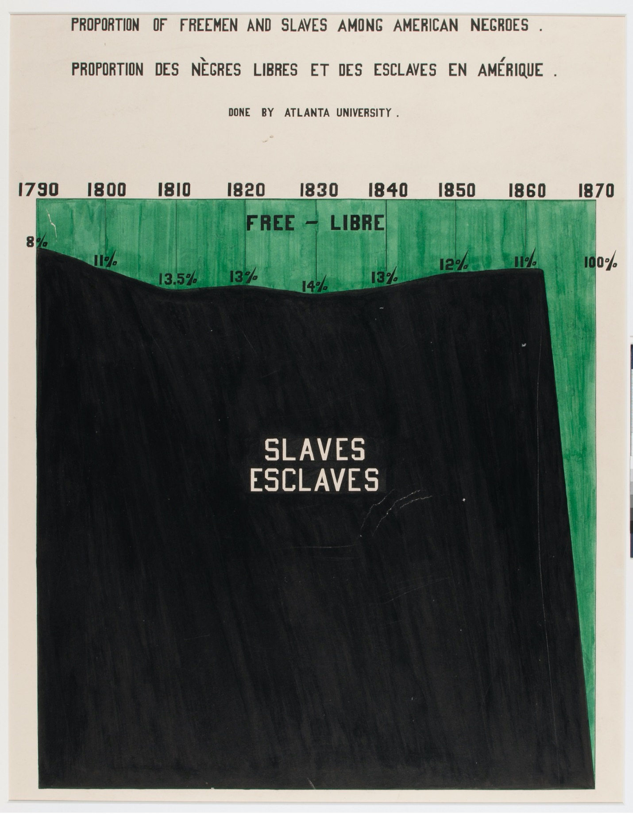
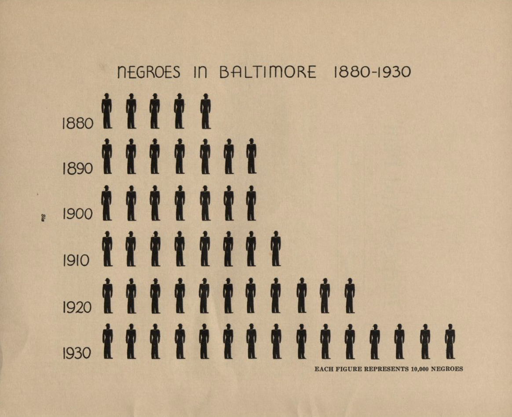
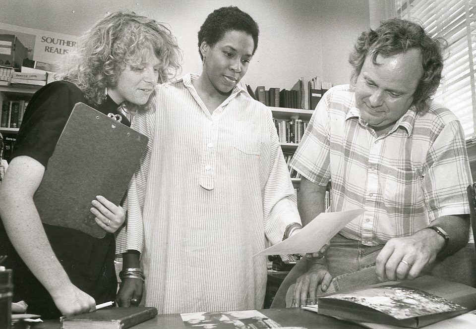
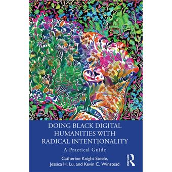

# {{ page.title }}

### What is Black digital humanities (Black DH)?

 "...a deeply political enterprise that seeks not simply to transform literary canons and historiography by incorporating black voices and centering an African American and African diasporic experience, though it certainly does that; black digital humanities troubles the very core of what we have come to know as the humanities by recovering alternate constructions of humanity that have been historically excluded from that concept." 

Proportion of Freed Versus Enslaved Blacks, W.E.B. Du Bois and Team and the University of Atlanta

Black digital humanities is by no means a new field. Since computer humanities emerged in the post World War II space, drawing on new computational power to solve complex humanities research questions, Black people have been involved in the space wherever possible. Though the foundations of DH are very privileged—centered on big technology corporations and universities with access to expensive hardware, research time, and staff power—Black people have been engaging with humanities data and using humanities data for research on Black history and culture for at least a century.

There are plenty of examples from the late 19th and early 20th century of data visualizations created by and about Black people. W.E.B. Dubois, one of the most well-known early civil rights activists, and a team of sociologists created data visualizations reporting on slavery in America and the movement of enslaved Africans across the globe around 1900. In 1935, sociologist Ira de Augustine Reid published The Negro Community of Baltimore, a study of the Black population in Baltimore, MD that includes infographic-style data visualizations. Visualizations like these are the precursor to the digital maps, charts, graphs, and graphics that you see online today.

"Negroes in Baltimore 1880-1930." In Reid, Ira De Augustine. The Negro Community of Baltimore, 1935, pg. 9.

It’s hard to date exactly when Black ***digital*** humanities emerged, largely because histories of computer humanities or digital humanities in general are nebulous. In 1983, Dr. Maryemma Graham at the University of Mississippi started the Computer Assisted Analysis of Black Literature project (later the Afro-American novel project), which sought to build a research tool for analysing works in English by Black writers by increasing access through a database and computational analysis. The project, now known as the History of Black Writing project, has expanded into a full, robust research center at the University of Kansas “focused on elevating innovative scholarship in American literature, book history, and digital humanities.” In their book, Doing Black Digital Humanities with Radical Intentionality: A Practical Guide, Catherine Knight Steele, Jessica H. Liu, and Kevin Winstead detail the rise of Afrofuturism and the creation of digital communities creating digital research content about the Black experience, including Afrofuturism.net and eBlackStudies (42). Steele et al. describe this period of digital humanities research in the 90s and early 2000s as characterised by “deficiency models of studying Blackness found in digital divide studies” that emphasised “Blackness as a problem in need of resolution” rather than affirming the lives, works, and humanity of Black people as worthy of scholastic engagement (42).

Maryemma Graham, inaugural staff member Susanne B. Dietzel, and David Deskins examine recently found work by Effie Waller Smith, early 20th century author from Pikeville, Kentucky. Smith’s work was compiled and edited by project staff members, and reprinted in the Schomburg Series of Black Women Writers (Oxford, 1991), with an introduction by fellow Kentuckian Deskins. The project’s most important early work resulted in other publications in the Schomburg and subsequent reprint series during the 1990s.

In 2008, the first official international conference combining Black studies and digital humanities was held at the University of Maryland: “Digital Diasporas: Digital Humanities and African American/African Diaspora Studies”. The conference’s stated aim was to provide a forum to critically discuss the “increasing centrality of digitization to the archiving of materials, as well as the growth of digital technology in the teaching, scholarship and artistic production in the field of African American/African Diaspora Studies”. Throughout the past 18 years, these large-scale efforts and an increased interest in Black culture in popular culture has led to a rapid expansion of Black digital humanities projects and interests. After the murder of Trayvon Martin in 2012, digital humanists scrambled to analyse social media trends and reactions and use digital methods for advocacy. For the nationwide march #RiseUpOctober in October 2015, a mass protest against police terror and police against Black individuals and families, digital humanists leveraged the new hashtag activism to monitor keywords and trends in the Twitter posts made surrounding the event. In 2018, the Intentionally Digital, Intentionally Black conference, hosted by the University of Maryland’s AADHum Initiative (Synergies among African American History and Culture and Digital Humanities), brought together scholars to talk about topics centring Black studies within the digital humanities, in opposition to the tendency of the digital humanities to marginalise or silo BIPOC topics within different fields and disciplines like literature, art, and history.

Steele, Catherine Knight, Jessica H. Lu, and Kevin Winstead. 2023. Doing Black Digital Humanities with Radical Intentionality: A Practical Guide. New York, NY: Routledge. https://www.taylorfrancis.com/books/9781003299134.

So what is Black digital humanities? Well, just as our guide on digital humanities says, the definition is flexible and changes depending on who you ask. But the difference in the Black digital humanities is that political, social, and financial inequity, racial justice, social activism, the recovery and preservation of lost narratives, and the push against marginalisation are all core parts of how Black digital humanities is practiced and discussed. Black DH centres Black digital humanists and scholars (like Kiran, who’s writing this!) and gives them space to be seen and heard. And Black DH pushes back against the idea that digital humanities should reinforce the same biases, archival gaps, and marginalisation of BIPOC voices that “the humanities” typically engages in. Want to see some examples? Explore the Black DH Project List below!

https://docs.google.com/document/d/1rZwucjyAAR7QiEZl238_hhRPXo5-UKXt2_KCrwPZkiQ/edit?usp=share_link

### Douglass Day
 Annually on February 14th, a group of national organizers host a virtual transcribe-a-thon to celebrate the life and achievements of abolitionist, writer, orator, and politician Frederick Douglass and his chosen birthday. The event allows participants to contribute to public history by transcribing digitized print documents on African American history into plain text. Cornell University Library’s Digital Scholarship Services and John Henrik Clarke Africana Library co-host an Annual Douglass Day Celebration, where participants are given sticky notes to reflect on two questions: what did you learn while transcribing and what is one thing that surprised you?   The following responses represent the thoughts of participants from Douglass Day 2023-2025. Click the New quote button to see a new participant response: 

 <iframe src="https://cornell-colab.github.io/douglass-day/" height="500"></iframe>
 
 ### Readings
 
 <iframe class="airtable-embed" src="https://airtable.com/embed/appVNJprQzTTfMRvh/shrlbfbmUnnpQNOg6?viewControls=on" frameborder="0" onmousewheel="" width="100%" height="533"></iframe>
